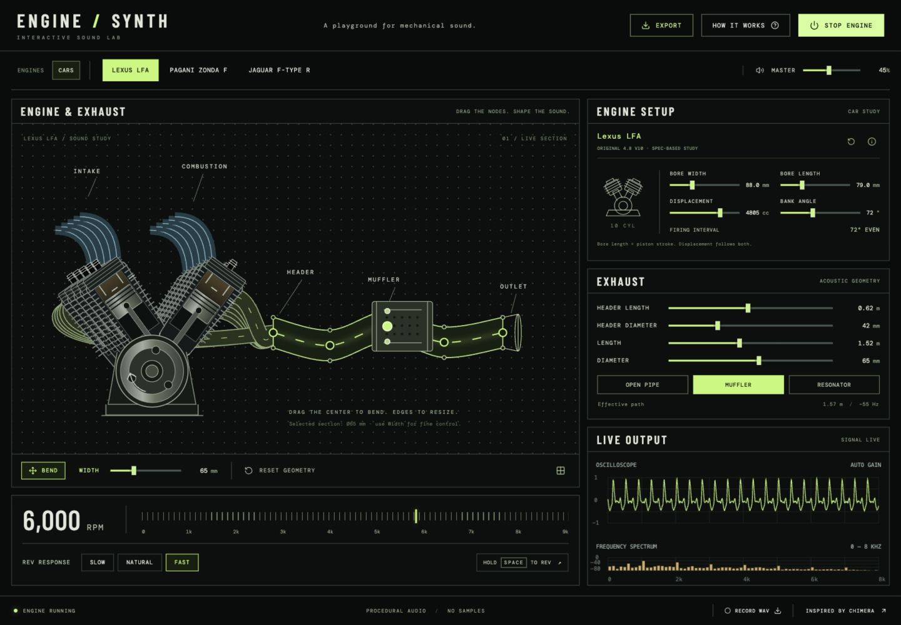

# Engine / Synth

**Build an engine sound. Bend the exhaust. Export the code.**

An open-source engine sound synthesizer for the browser, inspired by [Chimera](https://github.com/jamesondh/chimera-vocal-synth). Made for **games, JavaScript videos, motion graphics, and anyone who wants to play with mechanical sound**.

Choose an engine, shape its exhaust, and hear your changes live. When you find a sound you like, take it into your project as standalone JavaScript or a WAV recording.



[Get started](#quick-start) · [Use it in your project](#use-it-in-your-project) · [Contribute a preset](CONTRIBUTING.md) · [How it works](docs/ACOUSTICS.md) · [MIT license](LICENSE)

## Why this exists

Chimera makes physical sound modeling feel like something you can touch and explore. Engine / Synth takes that inspiration in another direction: **an engine sound synthesizer where the exhaust is part of the instrument**.

The goal is a playful workbench for designing engine sounds you can actually use. Make a little single-cylinder machine, experiment with a V12, or see what happens when you reshape the pipe.

## What you can do

- **Build an engine.** Single, parallel twin, V-twin, boxer, inline-four, V8, V10, V12, and W12 layouts.
- **Sculpt the sound.** Change bore, stroke, bank angle, header length, and exhaust geometry. Drag pipe centers to bend them and pipe edges to change their width.
- **Try different exhausts.** Open pipe, muffler, and side-branch resonator.
- **Rev it your way.** Slow, Natural, and Fast response, with a smooth return to your selected RPM. Hold **Space** or the on-screen rev button.
- **See what you hear.** Animated pistons, a live waveform, and a frequency spectrum.
- **Take the sound with you.** Export a standalone JavaScript module or record up to 60 seconds of mono WAV audio.

The audio is generated locally from simulated pressure pulses and acoustic waveguides. **No engine recordings or hosted audio service required.**

## A small garage to start with

The **Cars** tab includes three starting points:

| Sound study | Engine character |
| --- | --- |
| Lexus LFA | 4.8-litre V10 with balanced bank routing and equal-length primary runners |
| Pagani Zonda F | 7.3-litre V12 with a large-capacity exhaust pulse train |
| Jaguar F-Type R | 5.0-litre supercharged V8 with uneven bank pulses and modeled rotor whine |

Every study stays editable. Change its exhaust, hear the result, or reload the preset to return to its starting settings.

**These are first-pass physical sound studies, not exact reproductions of the real cars.** Manufacturer specifications inform the geometry; exhaust tuning and other acoustic assumptions still need recording-based calibration. [Read the sources and model notes](docs/ACOUSTICS.md).

## Quick start

Requires **Node.js 22.12+ or 20.19+** and npm.

After cloning or downloading the repository:

```sh
npm ci
npm run dev
```

Open the local URL printed by Vite, then click **Start engine**. Try an engine layout or open **Cars**, hold **Space** to rev, and drag the exhaust handles to experiment.

AudioWorklets require **localhost or HTTPS**, and browsers require a click or tap before audio starts.

```sh
npm test          # Run the audio, geometry, rev, and export checks
npm run build    # Build the static app into dist/
npm run preview  # Preview the production build locally
```

## Use it in your project

**For games:** drive the exported engine's RPM from your vehicle logic, and route it through your existing Web Audio graph.

**For JavaScript videos and motion graphics:** change RPM alongside a browser animation, or record a WAV to sync with your rendered video.

**For sound design:** explore unusual cylinder arrangements and exhaust shapes, then export the result for your next prototype.

### Export JavaScript

Click **Export** in the app, then **Download .js** or **Copy code**. The module includes your current sound engine and settings, including customized pipe geometry. It needs no npm packages, audio files, or companion app.

For example, after exporting the LFA study as `engine-synth-lfa.js`, add a `<button id="start">Start engine</button>` to your page:

```js
import { createEngineSound } from './engine-synth-lfa.js';

let engine;

document.querySelector('#start').addEventListener('click', async () => {
  engine ??= await createEngineSound();
  await engine.start();
  engine.setRpm(4500);
});

// Call this from your vehicle update or browser animation.
function updateEngineRpm(rpm) {
  engine?.setRpm(rpm);
}
```

Use `engine.update({ headerLength: 0.7, diameter: 70 })` to change parameters, `engine.stop()` to stop firing, and `await engine.dispose()` when finished. Pass `{ context, destination }` to `createEngineSound()` to use an existing AudioContext and output AudioNode.

### Record a WAV

Start the engine, click **Record WAV**, perform your revs, and click **Save WAV**. Recordings capture the synthesized signal before master volume and output compression.

## Help tune the garage

**Contributors wanted—especially people who know what these engines should sound like.**

The current LFA, Zonda F, and F-Type R studies are starting points. Help tune them, bring a different engine into the garage, or improve the physical model underneath them.

Good contributions include:

- **New tuned presets** with a clear engine/model/year, specification sources, and reference audio links.
- **Better existing presets:** improve the idle, firing character, induction sound, exhaust resonance, or rev response.
- **Useful comparisons:** level-matched before/after audio at known RPMs, spectra, or documented listening observations.
- **Better tools and examples** for integrating the synthesizer into games and JavaScript videos.

You do not need to overhaul the simulator to help. A well-explained preset adjustment is a valuable contribution.

**[Read the contributor guide →](CONTRIBUTING.md)**

## Under the hood

React + Vite for the workbench, Web Audio + AudioWorklets for real-time synthesis. The generic engine uses a segmented pressure-wave model; car studies add individual primary runners and two independent exhaust banks. Geometry affects travel time and reflections.

This is a creative audio instrument, not an engine-performance predictor. It does not solve complete combustion or nonlinear hot-gas flow. [The acoustic model notes](docs/ACOUSTICS.md) explain the current implementation, sources, and limitations.

## Inspiration and license

Inspired by **[Chimera](https://github.com/jamesondh/chimera-vocal-synth)** by [@jamesondh](https://github.com/jamesondh), whose browser-based vocal synthesizer sparked the idea of exploring physical sound through an interactive engine workbench.

Engine / Synth is released under the **[MIT License](LICENSE)**. Contributions and sound experiments are welcome.
